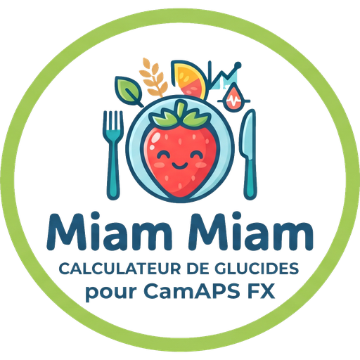
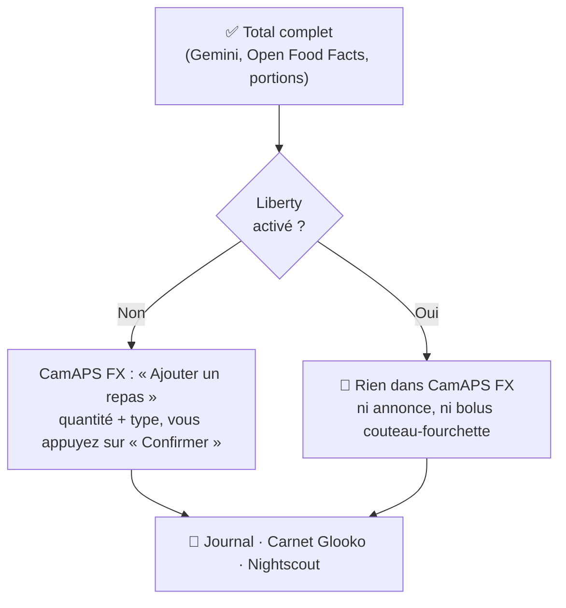
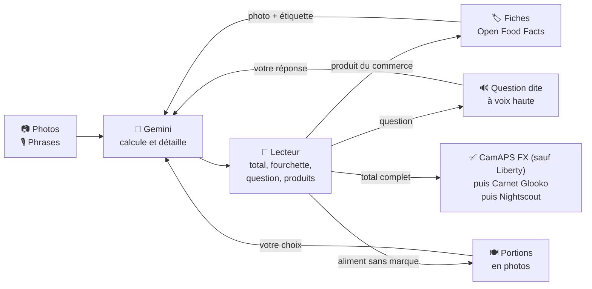
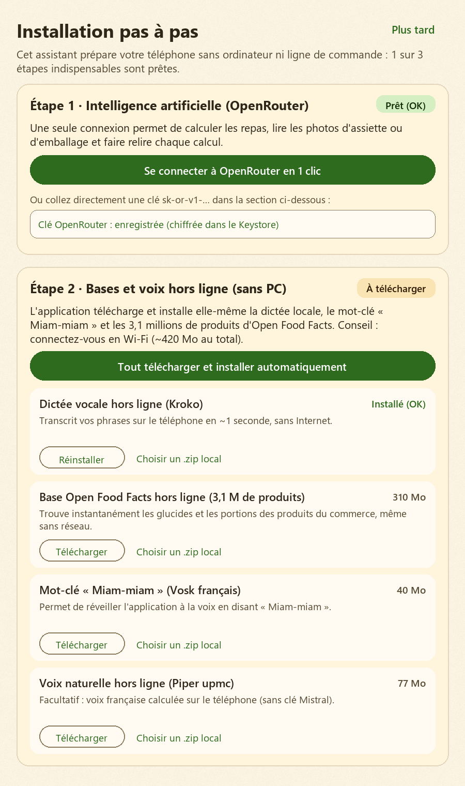
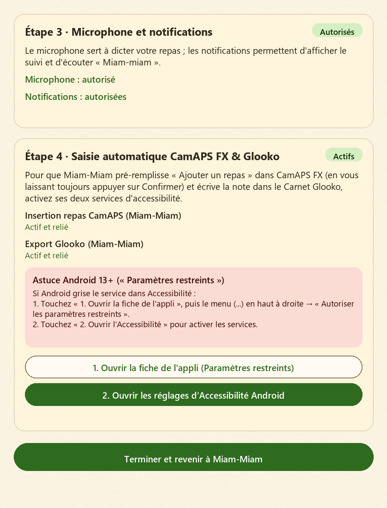
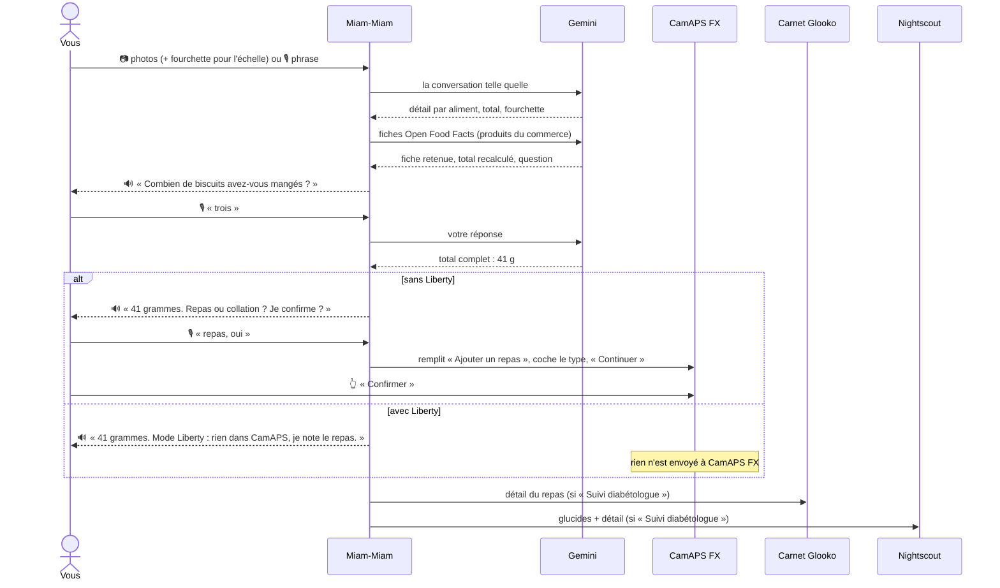
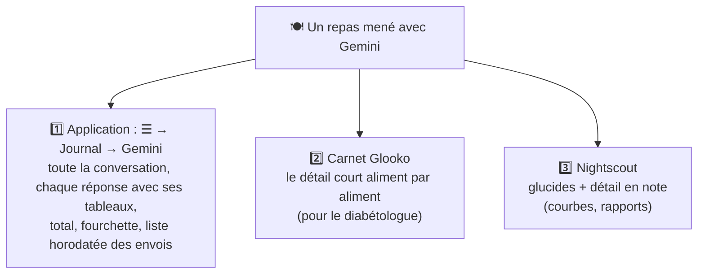

<p align="center">
  
</p>

# Miam-Miam pour CamAPS FX

*Nom de code du projet : **Meal Announcer** (identifiant `com.najah.mealannouncer`).*

Une application Android pour les personnes diabétiques de type 1 en boucle fermée **CamAPS FX**.
On **photographie** son assiette ou on **décrit** son repas à voix haute (*« Miam-miam, une
assiette de pâtes bolognaise et un yaourt »*). L'application calcule les glucides avec **Gemini**,
les dit à voix haute, pose les questions qui manquent, puis les inscrit dans **CamAPS FX**, dans le
**Carnet Glooko** et dans **Nightscout**.

> [!CAUTION]
> **Vous utilisez la fonction Liberty de CamAPS FX ?** Depuis le 24/11/2026, sur décision de
> l'équipe médicale, Miam-Miam **n'annonce plus aucun repas dans « Ajouter un repas »** pour les
> utilisateurs de Liberty. **Vous ne devez pas non plus annoncer vos repas dans « Ajouter un
> repas », ni faire de bolus avec l'onglet couteau-fourchette** de CamAPS FX. Le calcul, le
> journal, le Carnet Glooko et Nightscout continuent. **Référez-vous à votre diabétologue pour
> l'utilisation de Liberty.** Détails : [Utilisateurs de Liberty](#utilisateurs-de-liberty--à-lire-absolument).

> **Manuel pour débuter :** [`docs/MANUEL-UTILISATEUR.md`](docs/MANUEL-UTILISATEUR.md) (pas à pas,
> illustré, sans jargon).
>
> **Version actuelle : 0.16.0 du 24/11/2026** (mode Gemini direct, mode Liberty, nouveau logo).
> Le détail de chaque version est dans [`CHANGELOG.md`](CHANGELOG.md),
> les raisons de chaque choix dans [`docs/DECISIONS.md`](docs/DECISIONS.md) (52 décisions).

---

## Sommaire

1. [Pourquoi cette application](#pourquoi-cette-application)
2. [Utilisateurs de Liberty : à lire absolument](#utilisateurs-de-liberty--à-lire-absolument)
3. [Nouveau : le mode Gemini direct](#nouveau--le-mode-gemini-direct)
4. [Installer et configurer](#installer-et-configurer)
5. [Ce qu'elle ne fait pas, et ne fera pas](#ce-quelle-ne-fait-pas-et-ne-fera-pas)
6. [Un repas, du début à la fin](#un-repas-du-début-à-la-fin)
7. [D'où viennent les glucides](#doù-viennent-les-glucides)
8. [Les fonctions une par une](#les-fonctions-une-par-une)
9. [Les trois niveaux de journal](#les-trois-niveaux-de-journal)
10. [Les réglages](#les-réglages)
11. [Données personnelles, réseau et coûts](#données-personnelles-réseau-et-coûts)
12. [Suivre ce qui se passe (journaux techniques)](#suivre-ce-qui-se-passe-journaux-techniques)
13. [Pour les développeurs](#pour-les-développeurs)
14. [Avertissement médical](#avertissement-médical)
15. [Licences et crédits](#licences-et-crédits)

---

## Pourquoi cette application

Avec CamAPS FX, l'algorithme gère l'insuline, mais il faut lui **annoncer les glucides** de
chaque repas. Compter les glucides est la tâche la plus pénible du quotidien : chercher la valeur,
peser, faire la règle de trois, tout saisir à la main dans CamAPS, puis encore dans le carnet du
diabétologue.

Miam-Miam fait ce travail de comptage et de saisie :

- **on montre ou on parle** au lieu de taper : photos de l'assiette ou de l'emballage, dictée sur
  le téléphone, questions posées et réponses données à la voix ;
- **Gemini calcule** comme sur son site : il détaille chaque aliment, donne un total et une
  fourchette, et **demande ce qui manque** (quantité, part du paquet, cuisson, marque) ;
- **l'application vérifie avec de vraies données** : fiches Open Food Facts (3 millions de
  produits) pour les produits du commerce, banque de **862 aliments en photos pesées** pour le
  reste ;
- **la saisie** dans CamAPS FX, dans le Carnet Glooko et dans Nightscout est faite par
  l'application, mais **c'est vous qui confirmez dans CamAPS**. Exception : avec **Liberty**,
  rien n'est saisi dans CamAPS (section suivante).

---

## Utilisateurs de Liberty : à lire absolument

> [!CAUTION]
> **Décision de l'équipe médicale du 24/11/2026.** Pour les utilisateurs de CamAPS FX qui se
> servent de la fonction **Liberty** :
>
> - Miam-Miam **n'annonce plus les glucides dans « Ajouter un repas »** de CamAPS FX : ni saisie
>   automatique, ni ouverture de l'écran pour une saisie à la main ;
> - **vous ne devez pas non plus annoncer vos repas dans « Ajouter un repas »**, ni **faire de
>   bolus avec l'onglet couteau-fourchette** de CamAPS FX ;
> - **référez-vous à votre diabétologue** pour l'utilisation de Liberty : c'est lui qui décide si
>   et comment vous l'utilisez. Miam-Miam ne remplace pas son avis.

**Ce qui change** : la première partie de la séquence d'automatisation (l'annonce dans CamAPS FX)
est supprimée. **Tout le reste est conservé** : calcul avec Gemini, questions, journal de
l'application, Carnet Glooko, Nightscout (glucides et détail du repas), envoi des glycémies.



**Comment l'indiquer à Miam-Miam :**

1. **À l'installation**, la première étape de l'Assistant d'installation pose la question
   *« Utilisez-vous la fonction Liberty de CamAPS FX ? »* (**Oui, Liberty** / **Non**). Tant qu'elle
   n'a pas de réponse, l'assistant se rouvre à chaque lancement, **même après une mise à jour**.
2. **À tout moment**, dans **Paramètres → Repas & CamAPS → « J'utilise la fonction Liberty de
   CamAPS FX »**, un interrupteur l'active ou la désactive à la main.

**Ce que vous voyez en mode Liberty :**

| Écran | Sans Liberty | Avec Liberty |
| :-- | :-- | :-- |
| Assistant (total du repas) | « À écrire dans CamAPS : 41 g » · bouton **Écrire dans CamAPS** | « Total : 41 g — mode Liberty, à ne pas annoncer dans CamAPS » · bouton **Noter le repas (Liberty : rien dans CamAPS)** |
| Voix | « 41 grammes. Repas ou collation ? » puis « Je confirme ? » | « 41 grammes de glucides. Mode Liberty : rien dans CamAPS, je note le repas. » |
| Recherche manuelle | choix du type de repas · **Lancer l'automatisation (CamAPS FX)** | pas de type · **Noter le repas (Liberty : rien dans CamAPS)** |
| Réglages → Repas & CamAPS | « Insertion automatique dans CamAPS » proposée | l'insertion automatique est masquée (elle ne servirait à rien) |
| Journal → Automatisations | *Jusqu'au bout*, *CamAPS seulement*… | **Liberty (noté, rien dans CamAPS)** |

Même un total dicté (*« annonce 25 grammes »*, à la voix de la maison) n'entre plus dans CamAPS :
il est seulement noté. Par sécurité, la porte vers CamAPS est en plus **verrouillée** dans le code
sous Liberty : aucun chemin de l'application ne peut l'ouvrir.

> [!NOTE]
> Avec Liberty, les glucides n'arrivent plus dans Glooko par la synchronisation de CamAPS. Le
> **Carnet Glooko** (texte du repas, avec les grammes aliment par aliment) et **Nightscout**
> (glucides et détail) deviennent la trace du repas pour votre diabétologue : activez le mode
> **« Suivi diabétologue »** si vous voulez qu'ils soient écrits.

---

## Nouveau : le mode Gemini direct

Le 23/11/2026, un banc d'essai a montré que le modèle Gemini, interrogé **tel quel**, comptait
mieux les glucides que la chaîne de l'application (découpage en lignes, recherche, relecture par
un autre modèle). Le mode **Gemini direct**, activé par défaut, envoie donc la conversation
**telle quelle** à `google/gemini-4-hydrogen`, comme sur gemini.google.com (décision 50).



Ce qui change pour vous :

| Avant (chaîne « aliment par aliment ») | Maintenant (mode Gemini direct) |
| :-- | :-- |
| une seule photo à la fois | **jusqu'à 6 photos** par message ; après chaque cliché : « Autre photo ? » |
| l'IA découpait le repas en lignes, l'appli cherchait chaque ligne | **Gemini calcule tout**, l'appli lit son total et sa fourchette |
| un produit du commerce était cherché par son nom | l'appli cherche la fiche Open Food Facts **et l'envoie à Gemini avec sa photo** : il compare avec votre photo, retient la bonne fiche et recalcule avec l'étiquette |
| portions en photos pour quelques aliments | **862 aliments**, 2 195 photos pesées : toucher une photo dit à Gemini « ma portion ressemble à celle-ci » |
| pas de repère de taille | conseil : **poser une fourchette ou une cuillère** à côté du plat, elle sert d'échelle |
| une phrase seule lançait parfois une discussion | une phrase seule (*« j'ai bu une tasse de lait chocolaté »*) donne un calcul, ou une question |
| la réponse de l'IA n'était pas gardée | **toute la conversation** est gardée dans le Journal (onglet « Gemini ») |

Désactivé (Réglages → Repas & CamAPS → **Mode Gemini direct**), l'ancienne chaîne reprend sans
changement.

---

## Installer et configurer

Toute l'installation se fait **sur le téléphone**, sans ordinateur ni câble.

### 1. Installer l'APK

Télécharger le fichier **`Miam-Miam-<version>-arm64.apk`** depuis la page des
[versions publiées](https://github.com/Geeks4Good-fr/Miam-Miam-pour-CamAPS-FX/releases), dans le
navigateur du téléphone, puis l'ouvrir. Android demande d'autoriser l'installation depuis cette
source. Plus tard, les mises à jour se font depuis l'application (**☰ → À propos → Mises à
jour → Vérifier maintenant**).

> Lors d'une mise à jour, **vos réglages, votre clé d'IA, votre garde-manger et vos journaux sont
> conservés**.

### 2. Répondre à la question Liberty et donner une clé d'IA (les deux gestes obligatoires)

Au premier lancement, l'**Assistant d'installation** (5 étapes) s'ouvre tant qu'il manque la
réponse à la question Liberty ou la clé d'IA. On le retrouve à tout moment en haut des
**Paramètres**.

| Ancienne numérotation : étapes 1 et 2 | Ancienne numérotation : étapes 3 et 4 |
| :-: | :-: |
|  |  |

*Ces captures datent d'avant l'étape Liberty : chaque étape y porte le numéro d'avant (moins un).*

0. **Votre traitement : fonction Liberty de CamAPS FX** (étape 1 de l'assistant). Répondre
   **« Oui, Liberty »** ou **« Non »**. Avec Liberty, Miam-Miam n'annoncera **jamais** de repas
   dans CamAPS FX (voir [Utilisateurs de Liberty](#utilisateurs-de-liberty--à-lire-absolument)).
   **En cas de doute, demandez à votre diabétologue avant de répondre.** Le choix se change dans
   Paramètres → Repas & CamAPS.
1. **Intelligence artificielle.** Toucher **« Se connecter à OpenRouter en 1 clic »** : la page
   officielle d'OpenRouter s'ouvre, vous vous connectez, et la clé revient toute seule dans
   Miam-Miam, chiffrée par le **Keystore Android**. On peut aussi coller une clé `sk-or-v1-…`.
2. **Données hors ligne : rien à faire.** Dès que le téléphone est en **Wi-Fi**, avec assez de
   place et de batterie, Miam-Miam télécharge et installe tout seul ses paquets, l'un après
   l'autre, avec une notification de progression (environ 490 Mo compressés). Chaque archive est
   contrôlée par **SHA-256**. En cas de coupure, il réessaie plus tard.

   | Paquet | Taille | Sert à |
   | :-- | --: | :-- |
   | `off-base.db.zip` | 326 Mo → 653 Mo | 3,06 millions de produits Open Food Facts hors ligne |
   | `modele-portions.zip` | 66 Mo | **862 aliments, 2 195 photos pesées** (portions en images) |
   | `kroko-fr.zip` | 55 Mo | dictée en français sur le téléphone |
   | `vosk-model-fr.zip` | 42 Mo | écoute du mot-clé « Miam-miam » |
   | `piper-fr-upmc.zip` *(facultatif)* | 80 Mo | voix française calculée sur le téléphone |

   L'assistant garde ses boutons pour forcer le téléchargement en données mobiles ou installer
   un `.zip` déjà présent sur le téléphone.
3. **Microphone et notifications** : deux boutons, deux autorisations Android.
4. **Saisie automatique dans CamAPS FX et Glooko** (facultatif mais conseillé ; **avec Liberty,
   seul le service Glooko est utile**) :
   - sur Android 13 et plus, un APK installé hors Play Store a ses services d'accessibilité
     grisés. Bouton **« 1. Ouvrir la fiche de l'appli »** → menu `⋮` → *« Autoriser les paramètres
     restreints »* ;
   - bouton **« 2. Ouvrir les réglages d'Accessibilité »** → activer **« Insertion repas CamAPS
     (Miam-Miam) »** et **« Export Glooko (Miam-Miam) »**.

   Si ces services sont coupés (cas fréquent juste après une mise à jour), un **bandeau rouge**
   sur l'accueil le signale et donne les deux boutons pour les rallumer.

<details>
<summary>Installation par câble USB (développeurs)</summary>

```powershell
adb install -r Miam-Miam-<version>-arm64.apk
```

Des dossiers copiés à la main par `adb push` dans
`/sdcard/Android/data/com.najah.mealannouncer/files/` appartiennent à l'utilisateur `shell` :
l'application ne peut pas les lire sans `chmod`. Le téléchargement intégré n'a pas ce problème.

</details>

---

## Ce qu'elle ne fait pas, et ne fera pas

Ces limites sont des garde-fous, pas des options :

- elle **ne calcule aucune dose d'insuline** et ne donne aucune recommandation de dose ;
- dans CamAPS FX, elle n'utilise que l'écran **« Ajouter un repas »**, qui *informe* la boucle
  fermée. Ce n'est **pas** un bolus. Elle remplit la quantité et le type de repas après votre
  **« oui »** à voix haute, puis c'est **vous** qui validez dans CamAPS ;
- **avec Liberty, elle ne touche pas du tout à CamAPS FX** : ni « Ajouter un repas », ni
  ouverture de l'écran (décision de l'équipe médicale du 24/11/2026) ;
- elle ne pilote pas la pompe et ne modifie aucun réglage de l'algorithme ;
- elle **n'envoie rien tout seul tant qu'un doute reste** : en mode Gemini, l'envoi vers CamAPS
  n'est proposé que si Gemini a donné un total **complet** (rien de supposé) et qu'aucune question
  n'attend de réponse ;
- un aliment introuvable n'est **jamais compté zéro** : il est signalé ;
- aucun secret (clé d'IA, jeton Nightscout) n'est dans le dépôt, les préférences en clair ou les
  journaux : ils sont chiffrés par le **Keystore** Android.

---

## Un repas, du début à la fin



1. **Déclencher.** Dire *« Miam-miam »* (téléphone posé à côté de soi), toucher la tuile
   « Miam-miam » des réglages rapides, ou ouvrir l'appli et toucher **« Décrire mon repas à voix
   haute »**.
2. **Montrer.** **« Photographier l'assiette »** : après chaque cliché, Miam-Miam demande *« Autre
   photo ? »* (**Autre photo / Envoyer à Gemini / Annuler**). **« Choisir une photo »** : jusqu'à
   6 photos de la galerie d'un coup. Astuce affichée et dite au premier cliché : **une fourchette
   ou une cuillère à côté du plat** sert d'échelle.
3. **Ou dire.** *« J'ai bu une tasse de lait chocolaté »* suffit : Gemini calcule ou pose une
   question.
4. **Lire la réponse.** La carte **« Réponse de Gemini »** montre tout son texte, avec ses
   tableaux ; le total et la fourchette sont repris en haut. Une phrase courte est dite à voix
   haute.
5. **Produits du commerce.** Sous la réponse, les **fiches Open Food Facts comparées par Gemini**
   s'affichent, la fiche retenue cochée. Gemini a recalculé avec l'étiquette et demande la
   quantité qui manque (*« une portion ? 20 g ? 20 cl ? un quart du paquet ? »*).
6. **Aliments sans marque.** Une rangée de **photos de portions pesées** s'affiche : toucher
   celle qui ressemble à votre assiette, Gemini recalcule.
7. **Répondre.** Chaque question de Gemini est posée à voix haute ; votre réponse repart dans la
   conversation. On peut aussi dire *« ajoute un yaourt »*, *« retire le dernier »*, *« annule
   tout »*.
8. **Annoncer.** Quand le total est complet : *« 41 grammes. Repas ou collation ? »* puis
   *« Je confirme ? »*.
9. **Saisir dans CamAPS FX (sans Liberty seulement).** Sur votre *« oui »*, l'application ouvre
   « Ajouter un repas », remplit la quantité, coche le type et appuie sur « Continuer ». **Vous
   appuyez sur « Confirmer »** dans CamAPS. **Avec Liberty, cette étape n'existe plus** : rien
   n'est envoyé à CamAPS, et vous n'y annoncez rien non plus.
10. **Noter pour le médecin** (mode « Suivi diabétologue ») : le détail aliment par aliment est
    écrit dans le **Carnet Glooko**, puis envoyé à **Nightscout** avec les glucides.
11. **Garder la trace.** Toute la conversation est rangée dans **☰ → Journal → Gemini**. Si une
    étape a échoué, deux boutons la refont après coup : **« Noter dans le Carnet Glooko »** et
    **« Envoyer à Nightscout »**.

---

## D'où viennent les glucides

### En mode Gemini direct (par défaut)

| Source | Pour quoi | Comment |
| :-- | :-- | :-- |
| **Gemini** (`gemini-4-hydrogen`) | tout le repas : photos, phrases, plats maison | il détaille chaque aliment et donne un total avec une fourchette |
| **Fiches Open Food Facts** | produits du commerce vus ou nommés | code-barres lu, puis base du téléphone, puis en ligne ; 3 fiches au plus par produit, 4 produits au plus par repas ; Gemini compare les photos et recalcule avec l'étiquette |
| **Portions en images** | aliments sans marque (riz, pâtes, fruits, légumes, plats courants) | 862 aliments, 2 195 photos pesées ; votre choix est envoyé à Gemini |
| **Vous** | ce que la photo ne dit pas | quantités, part du paquet, cuisson, marque : Gemini pose la question |

Un second modèle, le **lecteur** (`gemini-3.1-flash-lite`), lit chaque réponse **sans rien
recalculer** : total, fourchette, phrase à dire, question, produits, aliments sans marque, et
surtout si le total est **complet**. Un total absurde (négatif, démesuré) est rejeté.

### En mode classique (mode Gemini direct désactivé)

L'ordre de recherche va **du plus sûr au moins sûr** : photo de l'emballage, garde-manger
personnel (factures, favoris), banque de portions, Open Food Facts hors ligne, Open Food Facts en
ligne, puis estimation de l'IA, toujours marquée « estimée ». Une marque dite passe devant ; le
riz, les pâtes, la semoule sont chiffrés **cuits** et l'application demande « cuit ou cru ? » ; un
article de facture n'est relié à une fiche que si les mots concordent.

---

## Les fonctions une par une

### Menu ☰

Six entrées : **Accueil**, **Annonce du repas**, **Recherche manuelle**, **Journal**,
**Paramètres**, **À propos**.

### Photos (mode Gemini)

- **Plusieurs photos par repas** : la caméra redemande *« Autre photo ? »* après chaque cliché ;
  la galerie accepte jusqu'à 6 photos d'un coup. Elles partent ensemble, dans un seul message.
- **Échelle** : une fourchette ou une cuillère posée à côté du plat aide Gemini à estimer les
  portions.
- **Emballages** : la photo d'un paquet, d'un code-barres ou d'un tableau nutritionnel permet de
  retrouver la vraie fiche du produit.
- Les photos ne sont **pas gardées** par l'application après l'envoi.

### Conversation et questions

- Gemini se souvient de tout l'échange : on corrige (*« non, trois biscuits »*), on ajoute, on
  retire.
- Chaque question de Gemini est **dite à voix haute** et la réponse est écoutée ; on peut aussi
  répondre en touchant l'écran.
- **« Recommencer »** ou *« annule tout »* vide la conversation.

### Fiches Open Food Facts comparées par Gemini

Pour chaque produit du commerce relevé, l'application envoie à Gemini les fiches candidates
**avec leur photo** : il compare avec la vôtre, retient une fiche (par son code-barres), recalcule
pour 100 g et demande la quantité. Essai réel : trois biscuits Prince → fiche retenue, le Petit
Beurre écarté, 41,4 g.

### Portions en images

- **862 aliments, 2 195 photos pesées** (valeurs Ciqual 2025 et index glycémique), installés
  automatiquement.
- Sous la réponse de Gemini : *« Votre portion de riz ressemble à laquelle ? »* ; toucher une
  photo l'envoie à Gemini.
- **Import / export de vos propres paquets** (`.zip` avec `portions.json` et les photos) :
  Paramètres → Données → Portions en images. Format : [`docs/PORTIONS.md`](docs/PORTIONS.md).

### Dictée et mot-clé « miam-miam »

- **Mot-clé hors ligne** (Vosk) : aucune fausse alerte sur 168 phrases de télévision ; une
  seconde écoute confirme avant de réveiller l'appli.
- **Dictée sur le téléphone** (Kroko) : environ 1 s de calcul pour 14 s de parole. En secours :
  Voxtral par OpenRouter.
- Arrêt automatique au silence ; tuile de réglages rapides.

### Recherche manuelle et favoris

- **☰ → Recherche manuelle** : base du téléphone d'abord, puis en ligne ; panier de plusieurs
  produits ; calculateur au poids, au volume, à la pièce, à la portion ou au paquet, avec la
  formule affichée ; bouton **« Lancer l'automatisation (CamAPS FX) »**.
- **Repas favoris** : un repas habituel rappelé en un geste.

### Mes enseignes et factures de courses

- **Enseignes habituelles** : leurs marques propres passent en tête des résultats.
- **Import d'une facture** (PDF de drive, photo de ticket, texte, Google Drive) : chaque article
  est relié une fois pour toutes à sa fiche et rangé dans le **garde-manger personnel**.

### La voix

- **Voxtral** (Mistral) : la plus naturelle ; **Piper** : hors ligne ; **voix Android** : repli.

### CamAPS FX et Carnet Glooko

- **Avec Liberty, rien de cette partie CamAPS ne s'applique** : seul le service Glooko sert.
- Deux **services d'accessibilité**, désactivés par défaut :
  - **« Insertion repas CamAPS (Miam-Miam) »** remplit « Ajouter un repas » et observe votre
    « Confirmer » ;
  - **« Export Glooko (Miam-Miam) »** écrit le détail du repas dans le Carnet Glooko après la
    confirmation, et pilote l'export CSV de Glooko.
- Le Carnet Glooko ne reçoit **que le texte** : les glucides y arrivent déjà par la
  synchronisation de CamAPS, il n'y a donc pas de doublon. Avec Liberty, ils n'y arrivent plus
  par CamAPS : le texte du Carnet (grammes par aliment) et Nightscout en gardent la trace.
- Détails : [`docs/CAMAPS-REPAS.md`](docs/CAMAPS-REPAS.md),
  [`docs/GLOOKO-CARNET.md`](docs/GLOOKO-CARNET.md).

### Nightscout

- En mode Gemini, chaque repas confirmé (ou noté, avec Liberty) part à Nightscout comme un traitement **« Carbs »** avec
  les glucides et le détail en note (*« Miam-Miam (Gemini) : potage 12 g, pâtes 45 g… »*).
- **Anti-doublon avec la synchronisation Glooko** : si une entrée Glooko de même valeur (± 1 g)
  existe déjà à ± 30 minutes, l'application n'envoie qu'une **note** sans glucides ; dans l'autre
  sens, le serveur n'écrit pas l'entrée Glooko quand celle de Miam-Miam est déjà là. L'heure
  envoyée est **toujours celle de CamAPS**, même pour un envoi après coup depuis le Journal.
- **Import des données Glooko** (CSV) vers Nightscout classique ou vers le fork *Nightscout for
  CamAPS FX*. Détail : [`docs/GLOOKO.md`](docs/GLOOKO.md).

### La voix de la maison

- Dicter son repas à une enceinte **Home Assistant Voice** (*« Okay Nabu, je mange… »*) : le
  calcul se fait sur le téléphone, les questions et l'annonce passent par l'enceinte.
  Conception : [`docs/VOIX-MAISON.md`](docs/VOIX-MAISON.md).

### Sauvegarde, mise à jour, support

- **Paramètres → Général → Sauvegarde** : un fichier JSON avec tous les réglages et les clés, pour
  changer de téléphone. ⚠️ Il contient les clés **en clair** : à garder en lieu sûr.
- **☰ → À propos** : version, licences, **mise à jour intégrée** (télécharge et installe la
  dernière version publiée), mode debug et envoi des journaux au support de Geeks4Good (ticket
  privé, effacé au bout de 30 jours).

---

## Les trois niveaux de journal



Le **Journal** (☰ → Journal) a trois onglets :

| Onglet | Contenu |
| :-- | :-- |
| **Automatisations** | chaque annonce envoyée à CamAPS et ce qu'elle est devenue : *Jusqu'au bout*, *CamAPS seulement*, *Annulé*, *Échec* ; avec Liberty : *Liberty (noté, rien dans CamAPS)* |
| **Repas** | l'historique des repas, avec leur total et leur détail ; « Favori » en un geste |
| **Gemini** | chaque repas du mode Gemini : **toute la conversation** (vos messages, mention des photos, réponses complètes de Gemini), total, fourchette, **Envois** horodatés ; boutons **Partager**, **Noter dans le Carnet Glooko**, **Envoyer à Nightscout** |

---

## Les réglages

Les **Paramètres** ont six onglets.

| Onglet | Ce qu'on y règle |
| :-- | :-- |
| **Général** | Assistant d'installation, clé d'IA (OpenRouter en 1 clic ou clé `sk-or-v1-…`), sauvegarde et restauration |
| **Repas & CamAPS** | **« J'utilise la fonction Liberty de CamAPS FX »** (en tête), **Mode Gemini direct**, insertion automatique dans CamAPS FX (masquée avec Liberty), **mode « Suivi diabétologue »** (Carnet Glooko, Nightscout, photo du plat), Glooko (import, synchronisation) |
| **Voix** | Voxtral, Piper ou voix Android ; mot-clé « miam-miam » ; voix de la maison |
| **Données** | portions en images (import / export, crédits) |
| **Courses** | enseignes habituelles, import de factures, garde-manger |
| **Avancé** | Nightscout (adresse, secret ou jeton, test de connexion, simulation) |

> **Liberty.** Activé, Miam-Miam n'annonce plus aucun repas dans CamAPS FX ; l'écran rappelle
> de ne pas annoncer le repas ni de faire de bolus avec l'onglet couteau-fourchette, et de se
> référer à son diabétologue. Le choix est gardé dans la sauvegarde des réglages.
>
> **Mode « Suivi diabétologue ».** Au quotidien, l'essentiel va au plus vite : CamAPS seulement.
> Ce mode ajoute, pour votre médecin, le détail du repas dans le Carnet Glooko et dans Nightscout.
> À activer par exemple les jours qui précèdent un rendez-vous.

---

## Données personnelles, réseau et coûts

Ce qui **reste sur le téléphone** : la dictée (Kroko), le mot-clé (Vosk), la voix Piper, la base
Open Food Facts, la banque de portions, le garde-manger, les journaux (dont les conversations
Gemini), les clés.

Ce qui **part sur Internet**, et pourquoi :

| Vers | Quoi | Quand |
| :-- | :-- | :-- |
| **OpenRouter** (Google Gemini, Mistral) | vos phrases, vos photos, les fiches Open Food Facts candidates, le contenu d'une facture importée | à chaque échange, chaque photo, chaque import |
| **Mistral** (Voxtral) | le texte des annonces | seulement si la voix Voxtral est choisie |
| **Open Food Facts** | un nom de produit ou un code-barres, la photo d'une fiche | seulement si la base locale ne l'a pas |
| **GitHub** (Geeks4Good-fr) | téléchargement des paquets hors ligne et des mises à jour | à l'installation, puis sur demande |
| **Votre Nightscout** | repas et données Glooko | seulement si c'est activé |

**Coût indicatif** (tarifs OpenRouter, novembre 2026) : en mode Gemini direct, environ
**4 centimes de dollar pour un repas de 3 échanges avec 2 photos**, 7 à 11 secondes par échange.

**Modèles utilisés :**

| Rôle | Modèle |
| :-- | :-- |
| mode Gemini direct : conversation, photos, calcul | `google/gemini-4-hydrogen` |
| mode Gemini direct : lecteur de la réponse (JSON) | `google/gemini-3.1-flash-lite` |
| mode classique : conversation, photos, factures | `google/gemini-3.1-flash-lite` |
| mode classique : relecture du repas, portions | `mistralai/mistral-medium-3.1` |
| dictée de secours | `mistralai/voxtral-small-24b-2507` |

---

## Suivre ce qui se passe (journaux techniques)

Tout est tracé dans `logcat`, sans aucune donnée secrète :

```bash
adb logcat -T 1 -v time -s MealAnnouncerMeal MealAnnouncerDirect MealAnnouncerLocal \
  MealAnnouncerTiming MealAnnouncerCamaps MealAnnouncerCarnet MealAnnouncerHome
```

| Étiquette | Contenu |
| :-- | :-- |
| `MealAnnouncerMeal` | chaque ligne du repas, sa source, le total, l'envoi à CamAPS |
| `MealAnnouncerDirect` | mode Gemini direct : échanges, fiches cherchées, résumé du lecteur, envois |
| `MealAnnouncerLocal` | dictée locale : durée de calcul, durée d'audio, texte |
| `MealAnnouncerTiming` | durée de chaque appel d'IA, jetons consommés |
| `MealAnnouncerCamaps` | ce que l'automate voit dans CamAPS, issue (« CONFIRMED »…) |
| `MealAnnouncerCarnet` | chaque étape de l'écriture dans le Carnet Glooko |
| `MealAnnouncerHome` | voix de la maison (enceinte) |

> Le journal Android ne garde que quelques minutes : lancer la commande **avant** l'essai.

---

## Pour les développeurs

### Compiler

```powershell
.\gradlew.bat test assembleDebug --console=plain     # tous les tests + APK de mise au point
.\gradlew.bat :feature:assistant:testDebugUnitTest   # tests d'un module
.\build.ps1                                          # APK release signé + empreinte SHA-256
```

- Sur un PC à la mémoire comptée, ajouter `"-Pkotlin.compiler.execution.strategy=in-process"`.
- La bibliothèque native **sherpa-onnx 1.13.8** (`app/libs/*.aar`, 50 Mo) n'est pas versionnée :
  la retélécharger comme indiqué dans [`docs/VOIX-LOCALE.md`](docs/VOIX-LOCALE.md).
- `testDebugUnitTest` ne lance que les modules Android ; le domaine (`core:model`, module
  Kotlin/JVM) ne tourne qu'avec `test`.

### Signature

L'APK release est signé avec `mealannouncer.jks` (alias `mealannouncer`) ; les mots de passe sont
dans `keystore.properties`. Ces deux fichiers ne sont **jamais** versionnés.

```powershell
& "$env:LOCALAPPDATA\Android\Sdk\build-tools\37.0.0\apksigner.bat" verify --print-certs app\build\outputs\apk\release\app-release.apk
```

### Pile technique

Kotlin 2.3, Jetpack Compose (BOM 2026.03), Hilt, Room (base version 3), WorkManager, DataStore ;
AGP 9.0, Gradle 9.1 ; `compileSdk 36`, `targetSdk 35`, `minSdk 29` ; APK limité à **arm64-v8a**.

### Structure

```
app/                       assemblage, thème aquarelle, menu, dictée locale (Kroko), mot-clé
core/model/                domaine pur (Kotlin/JVM) + tests ; GeminiMealLog
core/database/             Room : produits, repas, journal, gemini_meal_log
core/datastore/            réglages et secrets (Keystore)
feature/assistant/         conversation du repas, mode Gemini direct, fiches OFF, portions
feature/voice/             annonces : Voxtral, Piper, voix Android
feature/meal/              accueil, recherche manuelle, favoris
feature/history/           journal (Automatisations, Repas, Gemini)
feature/settings/          réglages, assistant d'installation, paquets hors ligne
data/mistral/              appels d'IA (OpenRouter), dont GeminiDirect.kt
data/openfoodfacts/        base hors ligne, API, garde-fou des factures
data/nightscout/           client Nightscout (v1 et v3), anti-doublon Glooko
integration/camaps/        saisie dans CamAPS FX (accessibilité)
integration/glooko/        CSV Glooko → Nightscout
integration/glookoexport/  pilotage de Glooko : export CSV, Carnet
```

### Documents

| Document | Sujet |
| :-- | :-- |
| [`docs/MANUEL-UTILISATEUR.md`](docs/MANUEL-UTILISATEUR.md) | manuel pas à pas pour débuter |
| [`docs/PROMPT-GEMINI-NOTEBOOKLM.md`](docs/PROMPT-GEMINI-NOTEBOOKLM.md) | consignes pour produire un manuel visuel et vidéo avec Gemini / NotebookLM |
| [`docs/DECISIONS.md`](docs/DECISIONS.md) | les 52 décisions et leurs raisons (50 : mode Gemini direct ; 51 : paquets automatiques ; 52 : mode Liberty) |
| [`docs/DIALOGUE-REPAS.md`](docs/DIALOGUE-REPAS.md) | la conversation du repas (mode classique) |
| [`docs/PORTIONS.md`](docs/PORTIONS.md) | banque de portions en images, format des paquets |
| [`docs/OFF-LOCAL.md`](docs/OFF-LOCAL.md) | fabrication de la base Open Food Facts hors ligne |
| [`docs/PHOTO-ASSIETTE.md`](docs/PHOTO-ASSIETTE.md) | lecture des photos |
| [`docs/MIAM-MIAM.md`](docs/MIAM-MIAM.md) | mot-clé « miam-miam » |
| [`docs/VOIX-LOCALE.md`](docs/VOIX-LOCALE.md), [`docs/VOXTRAL.md`](docs/VOXTRAL.md) | dictée et voix |
| [`docs/CAMAPS-REPAS.md`](docs/CAMAPS-REPAS.md) | saisie dans CamAPS FX |
| [`docs/GLOOKO.md`](docs/GLOOKO.md), [`docs/GLOOKO-CARNET.md`](docs/GLOOKO-CARNET.md) | import Glooko, Carnet |
| [`docs/VOIX-MAISON.md`](docs/VOIX-MAISON.md) | voix de la maison (Home Assistant) |

### Choix notables

- **Mode Gemini direct** : une seule consigne permanente (`DIRECT_CONTEXT`), la conversation
  part telle quelle ; le lecteur ne recalcule jamais, il lit.
- **Mode classique** : le modèle ne fournit jamais un nombre de glucides, l'application calcule.
- **Toute modification d'une consigne d'IA demande un essai réel.**
- **Énumérations stockées par leur nom**, jamais par leur ordinal.
- **Une migration Room est toujours additive** : rien n'est perdu à la mise à jour.

---

## Avertissement médical

Cette application aide à **compter et saisir des glucides**. Elle ne calcule pas d'insuline, ne
remplace pas un avis médical, et ses valeurs, même calculées par Gemini et vérifiées sur une
étiquette, peuvent être fausses. **Vérifiez toujours le total avant de confirmer dans CamAPS FX.**

**Liberty :** si vous utilisez la fonction Liberty de CamAPS FX, n'annoncez pas vos repas dans
« Ajouter un repas » et ne faites pas de bolus avec l'onglet couteau-fourchette ; Miam-Miam ne le
fait pas non plus. **L'utilisation de Liberty se décide avec votre diabétologue : référez-vous à
lui.**

Ce projet n'est affilié ni à CamDiab (CamAPS FX), ni à Glooko, ni à Google (Gemini), ni à
Open Food Facts, ni à Nightscout.

## Licences et crédits

- **Code** : usage personnel, pas encore de licence publiée.
- **Logo et icône** (fraise dans l'assiette, *« Miam Miam — calculateur de glucides pour CamAPS
  FX »*) : fourni par le porteur du projet ; fichier [`docs/images/logo-miam-miam.png`](docs/images/logo-miam-miam.png).
- **Banque de portions embarquée** (33 aliments) : jeu de données **Nutrition5k** (Google
  Research), licence **CC BY 4.0**.
- **Grande banque de portions** (`modele-portions.zip`, 862 aliments) : photos sous licence
  **CC BY** de Geeks4Good, **Patrick Blan** et **Alexandre Roschewitz** (auteur indiqué photo par
  photo, voir `CREDITS.md` dans l'archive) ; valeurs Ciqual 2025.
- **Open Food Facts** : base sous licence **ODbL**, images CC BY-SA.
- **Police Dancing Script** : licence **SIL Open Font License** ([`docs/licences/`](docs/licences/)).
- **Vosk** et **sherpa-onnx** : licence Apache 2.0.
- **Kroko** (dictée) et **Piper upmc** (voix) : licences de leurs modèles, **à vérifier avant
  toute diffusion publique** (voir [`docs/VOIX-LOCALE.md`](docs/VOIX-LOCALE.md)).
