# 🍓 Miam-Miam pour CamAPS FX : le manuel pour bien débuter

<p align="center">
  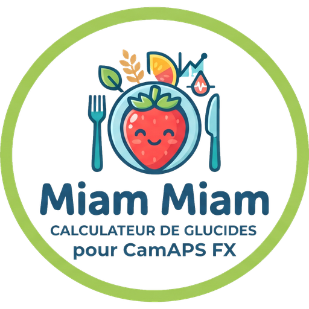
</p>

*Pour toute personne qui n'a jamais utilisé l'application. Aucune connaissance technique n'est
nécessaire. Version du manuel : 24/11/2026, application 0.16.0 (mode Gemini direct, mode
Liberty).*

> [!IMPORTANT]
> **Miam-Miam ne calcule jamais d'insuline.** Elle compte les glucides de votre repas et les
> **annonce** à CamAPS FX dans l'écran « Ajouter un repas ». Cette annonce **informe** la boucle
> fermée, ce n'est **pas** un bolus. C'est **toujours vous** qui validez dans CamAPS. Vérifiez le
> total avant de confirmer.

> [!CAUTION]
> **Vous utilisez la fonction Liberty de CamAPS FX ?** Alors Miam-Miam **n'annonce rien** dans
> « Ajouter un repas », et **vous non plus** : n'annoncez pas vos repas dans « Ajouter un repas »
> et **ne faites pas de bolus avec l'onglet couteau-fourchette** de CamAPS FX. **Référez-vous à
> votre diabétologue** pour l'utilisation de Liberty. Lisez d'abord le
> [chapitre 0](#0-avant-tout--utilisez-vous-liberty-).

---

## Sommaire

0. [⚠️ Avant tout : utilisez-vous Liberty ?](#0-avant-tout--utilisez-vous-liberty-)
1. [Miam-Miam en une image](#1-miam-miam-en-une-image)
2. [Ce qu'il vous faut](#2-ce-quil-vous-faut)
3. [Installer l'application (10 minutes)](#3-installer-lapplication-10-minutes)
4. [Découvrir l'écran d'accueil et le menu](#4-découvrir-lécran-daccueil-et-le-menu)
5. [Votre premier repas, en photo](#5-votre-premier-repas-en-photo)
6. [Un repas sans photo, à la voix](#6-un-repas-sans-photo-à-la-voix)
7. [Les produits du commerce (paquets, biscuits, yaourts)](#7-les-produits-du-commerce)
8. [Les aliments sans marque : les portions en photos](#8-les-aliments-sans-marque--les-portions-en-photos)
9. [Confirmer dans CamAPS FX](#9-confirmer-dans-camaps-fx)
10. [Pour votre diabétologue : le mode « Suivi »](#10-pour-votre-diabétologue--le-mode-suivi)
11. [Le Journal : retrouver et rattraper un repas](#11-le-journal--retrouver-et-rattraper-un-repas)
12. [Chercher un produit à la main, garder ses favoris](#12-chercher-un-produit-à-la-main-garder-ses-favoris)
13. [Bien photographier son assiette](#13-bien-photographier-son-assiette)
14. [Les réglages utiles](#14-les-réglages-utiles)
15. [Que faire si…](#15-que-faire-si)
16. [Petit lexique](#16-petit-lexique)

---

## 0. Avant tout : utilisez-vous Liberty ?

**Liberty** est une fonction de CamAPS FX. **C'est votre diabétologue qui décide si vous
l'utilisez, et comment.** Si vous ne savez pas, **posez-lui la question avant d'utiliser
Miam-Miam**.

Le 24/11/2026, l'équipe médicale a décidé que, pour les personnes qui utilisent Liberty, **aucun
repas ne doit être annoncé dans « Ajouter un repas »** de CamAPS FX. Miam-Miam s'y plie : avec
Liberty, il compte vos glucides et note votre repas, mais **ne touche jamais à CamAPS FX**.

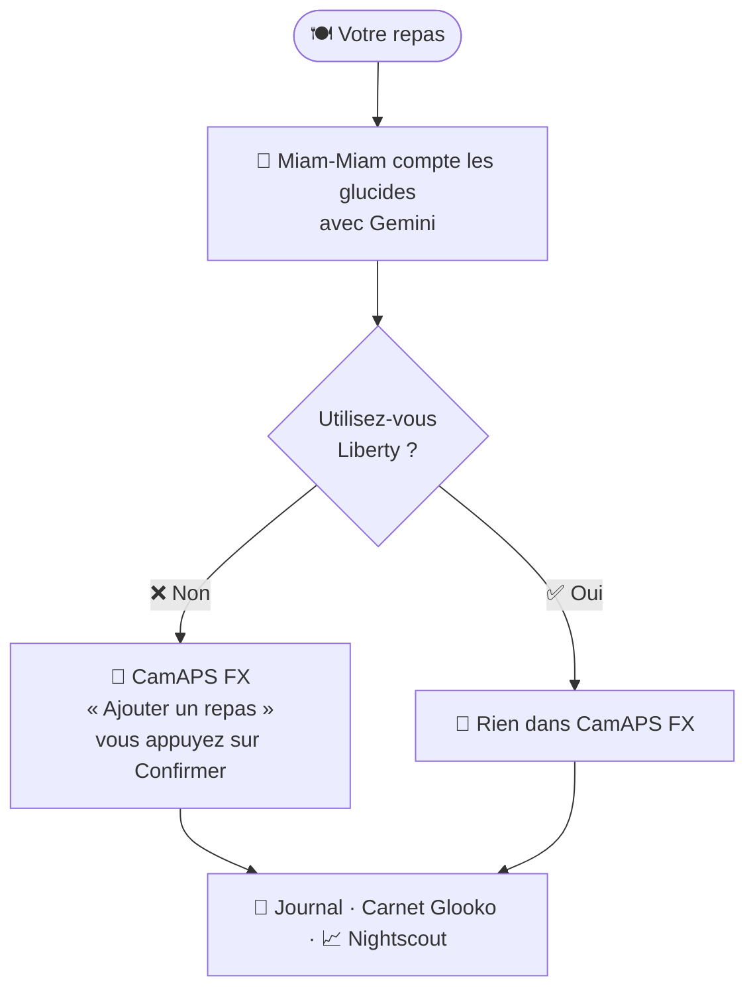

### Avec Liberty : ce que vous faites, ce que vous ne faites plus

| ✅ Vous continuez | 🚫 Vous ne faites plus |
| :-- | :-- |
| photographier ou dicter votre repas | annoncer le repas dans **« Ajouter un repas »** de CamAPS FX |
| répondre aux questions de Gemini | faire un **bolus avec l'onglet couteau-fourchette** 🍴 de CamAPS FX |
| lire le total de glucides | demander à Miam-Miam d'écrire dans CamAPS (il ne le fera pas) |
| garder la trace dans le Journal, le Carnet Glooko et Nightscout | |

> [!CAUTION]
> Ces consignes viennent de l'équipe médicale. **Pour tout ce qui touche à Liberty (l'activer,
> l'arrêter, ce qu'il faut faire au moment des repas), référez-vous à votre diabétologue.**
> Miam-Miam ne remplace pas son avis.

### Comment le dire à Miam-Miam

**1. À l'installation.** La toute première étape de l'Assistant d'installation vous pose la
question :

```
┌────────────────────────────────────────────────────┐
│ ① Votre traitement : fonction Liberty   À répondre │
│                                                    │
│  Utilisez-vous la fonction Liberty de CamAPS FX ?  │
│                                                    │
│  • Oui (Liberty) : Miam-Miam calcule et note le    │
│    repas, mais n'annonce JAMAIS les glucides dans  │
│    « Ajouter un repas ».                           │
│  • Non : Miam-Miam peut préparer l'annonce ; vous  │
│    confirmez toujours vous-même.                   │
│                                                    │
│  L'utilisation de Liberty se décide avec votre     │
│  diabétologue.                                     │
│                                                    │
│   ┌────────────────┐      ┌────────────────┐       │
│   │  Oui, Liberty  │      │      Non       │       │
│   └────────────────┘      └────────────────┘       │
└────────────────────────────────────────────────────┘
```

<p align="center">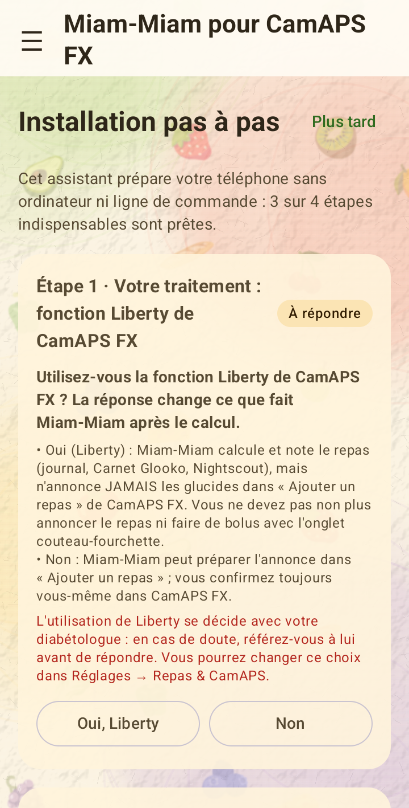</p>

Tant que vous n'avez pas répondu, l'assistant **revient à chaque ouverture** de Miam-Miam (même
après une mise à jour) : cette question est trop importante pour être oubliée.

**2. À tout moment.** **☰ → Paramètres → Repas & CamAPS**, tout en haut :

```
┌────────────────────────────────────────────────────┐
│ J'utilise la fonction Liberty de CamAPS FX   [●══] │
│ Liberty activé : Miam-Miam n'annonce PLUS AUCUN    │
│ repas dans « Ajouter un repas »… Ne faites pas non │
│ plus de bolus avec l'onglet couteau-fourchette.    │
│ L'utilisation de Liberty se décide avec votre      │
│ diabétologue : référez-vous à lui.                 │
└────────────────────────────────────────────────────┘
```

<p align="center">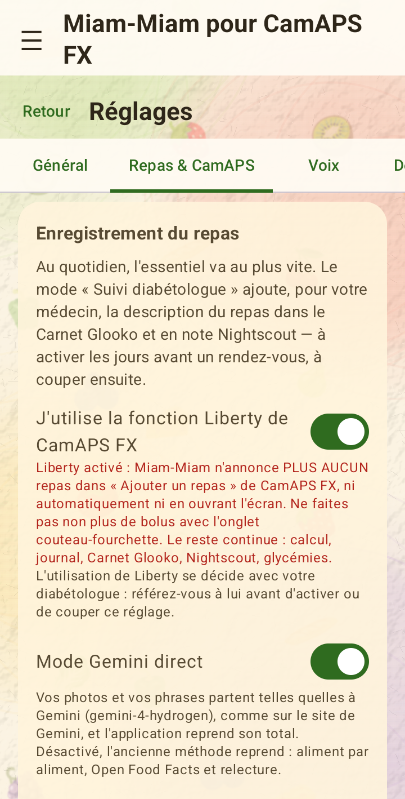</p>

### Ce qui change à l'écran avec Liberty

<p align="center">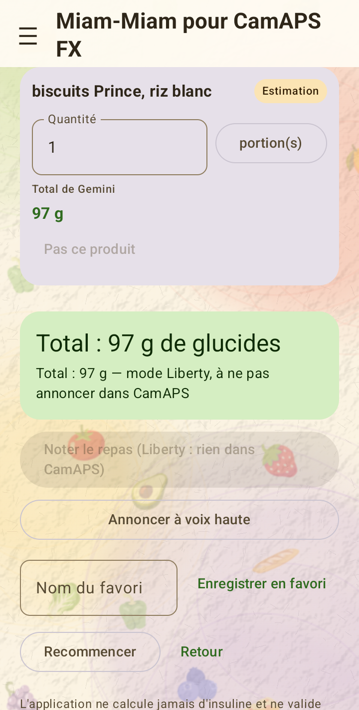</p>

| Où | Sans Liberty | Avec Liberty |
| :-- | :-- | :-- |
| Total du repas | « À écrire dans CamAPS : 41 g » | « Total : 41 g — mode Liberty, à ne pas annoncer dans CamAPS » |
| Gros bouton | **Écrire dans CamAPS** | **Noter le repas (Liberty : rien dans CamAPS)** |
| Voix | « 41 grammes. Repas ou collation ? » | « 41 grammes de glucides. Mode Liberty : rien dans CamAPS, je note le repas. » |
| Recherche manuelle | choix « Repas / Collation… » et **Lancer l'automatisation (CamAPS FX)** | **Noter le repas (Liberty : rien dans CamAPS)** |
| Journal → Automatisations | ✅ *Jusqu'au bout*, 🟡 *CamAPS seulement*… | 🔵 **Liberty (noté, rien dans CamAPS)** |

> [!TIP]
> Avec Liberty, activez le mode **« Suivi diabétologue »** ([chapitre 10](#10-pour-votre-diabétologue--le-mode-suivi)) :
> comme rien ne passe plus par CamAPS, c'est le **Carnet Glooko** et **Nightscout** qui gardent
> la trace de vos repas pour votre médecin.

---

## 1. Miam-Miam en une image

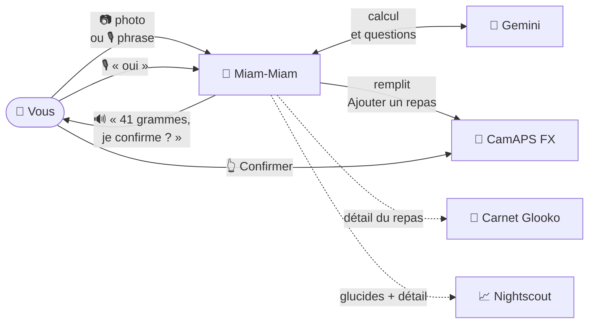

**En une phrase :** vous montrez ou dites ce que vous mangez, Gemini compte les glucides et pose
les questions utiles, Miam-Miam remplit CamAPS, et vous n'avez plus qu'à appuyer sur
« Confirmer ».

Les flèches en pointillé sont **facultatives** : elles servent à votre médecin (voir
[chapitre 10](#10-pour-votre-diabétologue--le-mode-suivi)).

> [!IMPORTANT]
> **Avec Liberty**, les flèches vers CamAPS FX disparaissent : pas de « je confirme ? », rien dans
> « Ajouter un repas ». Il reste le calcul, le total dit à voix haute et la trace du repas
> ([chapitre 0](#0-avant-tout--utilisez-vous-liberty-)).

---

## 2. Ce qu'il vous faut

| | Obligatoire | Pourquoi |
| :-: | :-- | :-- |
| 📱 | Un téléphone **Android 10 ou plus récent** (processeur 64 bits) | l'application ne fonctionne pas sur iPhone |
| 💉 | **CamAPS FX** installé et en marche | c'est lui qui reçoit les glucides (**sauf avec Liberty** : rien ne lui est envoyé) |
| 🩺 | **Savoir si vous utilisez Liberty** | l'application vous le demande ; en cas de doute, **demandez à votre diabétologue** |
| 🔑 | Un compte **OpenRouter** avec un peu de crédit (quelques euros suffisent pour des mois) | c'est par là que Gemini est interrogé : environ 4 centimes par repas photographié |
| 📶 | Le **Wi-Fi** pour l'installation | environ 500 Mo de données à télécharger une seule fois |

| | Facultatif | Pourquoi |
| :-: | :-- | :-- |
| 📒 | L'application **Glooko** | pour que le détail des repas apparaisse dans le carnet que voit votre diabétologue |
| 📈 | Un site **Nightscout** | pour voir les repas sur vos courbes de glycémie |
| 🍴 | Une **fourchette** ou une **cuillère** | posée à côté de l'assiette, elle sert d'échelle sur les photos |

---

## 3. Installer l'application (10 minutes)

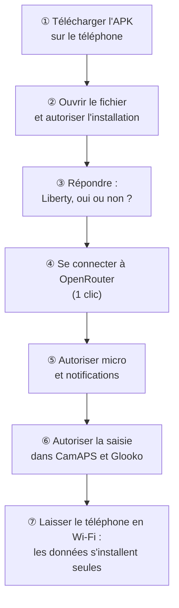

### ① Télécharger l'application

1. Sur le téléphone, ouvrez le navigateur (Chrome, par exemple).
2. Allez sur la page **github.com/Geeks4Good-fr/Miam-Miam-pour-CamAPS-FX/releases**.
3. Touchez le fichier qui se termine par **`-arm64.apk`**.

### ② L'installer

1. Ouvrez le fichier téléchargé (notification ou dossier **Téléchargements**).
2. Android prévient qu'il s'agit d'une source inconnue : touchez **Paramètres**, activez
   **« Autoriser cette source »**, puis revenez et touchez **Installer**.

> [!NOTE]
> Ce message est normal : l'application n'est pas sur le Play Store. Il n'apparaîtra plus pour
> les mises à jour, qui se feront depuis l'application elle-même.

### ③ Répondre à la question « Liberty »

Au premier lancement, l'**Assistant d'installation** s'ouvre tout seul. Sa **première étape**
demande : *« Utilisez-vous la fonction Liberty de CamAPS FX ? »*

- Touchez **« Oui, Liberty »** si votre diabétologue vous a mis sous Liberty : Miam-Miam
  n'écrira **jamais** dans CamAPS FX.
- Touchez **« Non »** sinon : Miam-Miam pourra préparer l'annonce dans « Ajouter un repas ».

> [!CAUTION]
> **Vous ne savez pas ?** Ne devinez pas : **demandez à votre diabétologue**. En attendant, vous
> pouvez fermer l'assistant avec « Plus tard » ; il vous reposera la question au prochain
> lancement. Tout le détail est au [chapitre 0](#0-avant-tout--utilisez-vous-liberty-).

### ④ Se connecter à OpenRouter

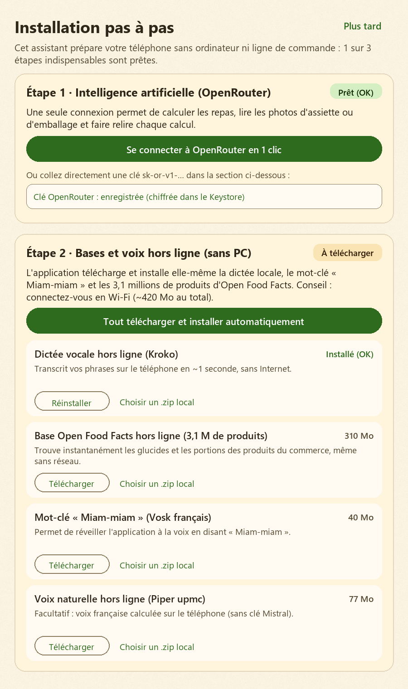

*(Capture prise avant l'ajout de la question Liberty : les numéros d'étape y sont décalés d'un
cran.)*

1. Touchez **« Se connecter à OpenRouter en 1 clic »**.
2. La page d'OpenRouter s'ouvre : connectez-vous (ou créez un compte), puis acceptez.
3. Vous revenez tout seul dans Miam-Miam : l'étape 2 passe au vert ✅.

> [!TIP]
> Vous n'avez **rien à copier**. La clé est rangée dans le coffre-fort chiffré du téléphone ;
> personne, pas même l'application de sauvegarde, ne peut la lire en clair.

### ⑤ Micro et notifications

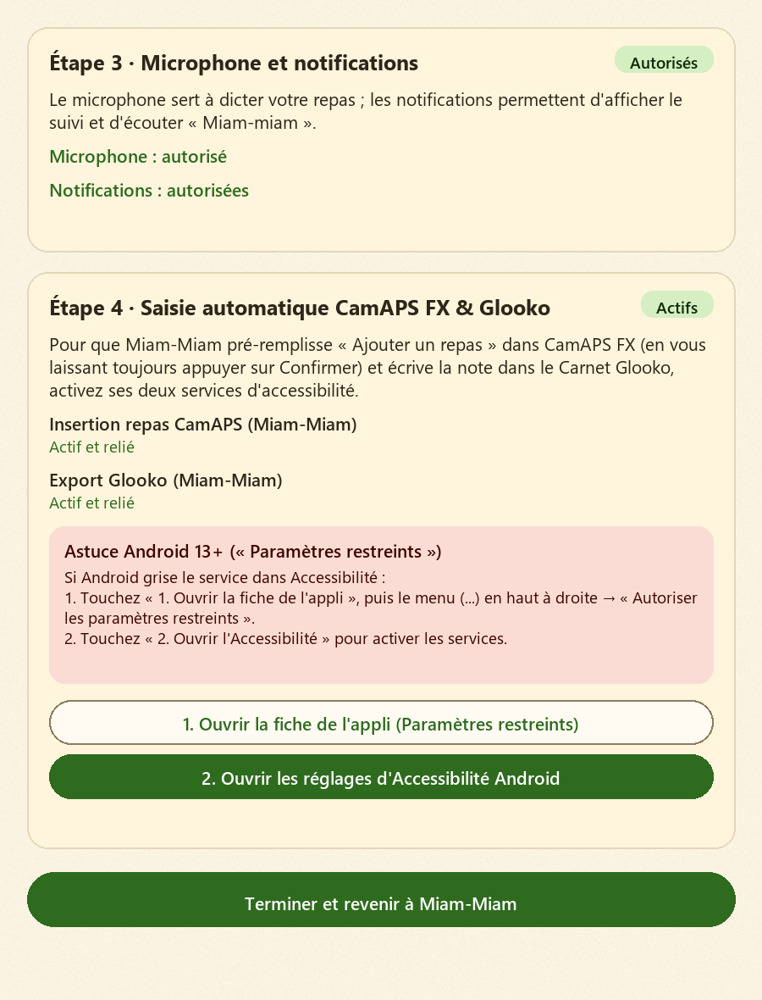

Touchez les deux boutons et répondez **Autoriser** :

- 🎙️ **Microphone** : pour dicter votre repas et répondre aux questions ;
- 🔔 **Notifications** : pour voir le téléchargement des données et l'écoute du mot-clé.

### ⑥ Autoriser la saisie dans CamAPS FX et Glooko

C'est l'étape la plus délicate, mais elle se fait **une seule fois**. Elle permet à Miam-Miam de
remplir l'écran « Ajouter un repas » de CamAPS à votre place.

> [!NOTE]
> **Avec Liberty**, Miam-Miam n'écrit pas dans CamAPS : le service « Insertion repas CamAPS » ne
> sert à rien. N'activez que **« Export Glooko (Miam-Miam) »**, si vous utilisez Glooko.

1. Touchez **« 1. Ouvrir la fiche de l'appli »**.
2. En haut à droite, touchez les **trois points ⋮**, puis **« Autoriser les paramètres
   restreints »**. Confirmez avec votre code ou votre empreinte.
3. Revenez dans Miam-Miam et touchez **« 2. Ouvrir les réglages d'Accessibilité »**.
4. Activez **« Insertion repas CamAPS (Miam-Miam) »**, puis **« Export Glooko (Miam-Miam) »** si
   vous utilisez Glooko.

> [!WARNING]
> Android coupe parfois ces deux services après une **mise à jour** de Miam-Miam. Un **bandeau
> rouge** apparaît alors sur l'accueil, avec les deux mêmes boutons : refaites les gestes 1 à 4.

### ⑦ Laisser faire

Laissez le téléphone **en Wi-Fi**. Miam-Miam télécharge seul, avec une notification de
progression :

| 📦 Paquet | Ce qu'il apporte |
| :-- | :-- |
| 🏷️ Base Open Food Facts | 3 millions de produits du commerce, consultables sans Internet |
| 🍽️ Portions en photos | 862 aliments photographiés à différentes portions pesées |
| 🎙️ Dictée | comprendre votre voix sans Internet |
| 👂 Mot-clé | réagir quand vous dites « Miam-miam » |
| 🗣️ Voix *(facultatif)* | une voix française qui parle sans Internet |

Vous pouvez déjà utiliser l'application pendant ce temps.

---

## 4. Découvrir l'écran d'accueil et le menu

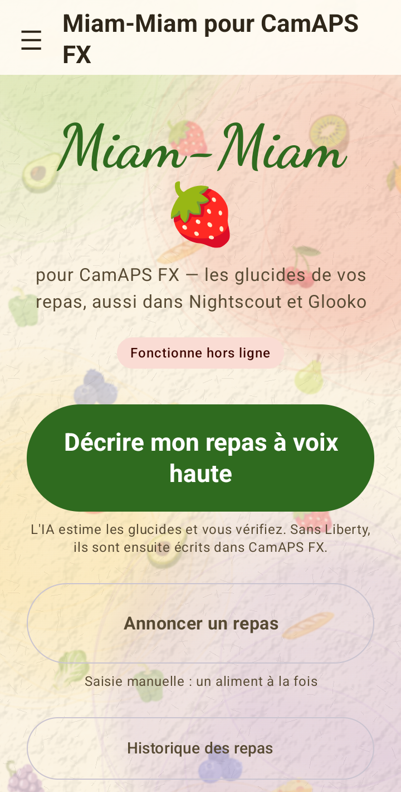

| Repère | Élément | À quoi il sert |
| :-: | :-- | :-- |
| ☰ | **Menu** (en haut à gauche) | aller partout dans l'application |
| 🎙️ | **Décrire mon repas à voix haute** | le bouton principal : photos ou voix, Gemini calcule |
| ✍️ | **Annoncer un repas** | saisie à la main, un aliment à la fois |
| 🟥 | **Bandeau rouge** (s'il apparaît) | la saisie dans CamAPS est coupée : suivez ses deux boutons |

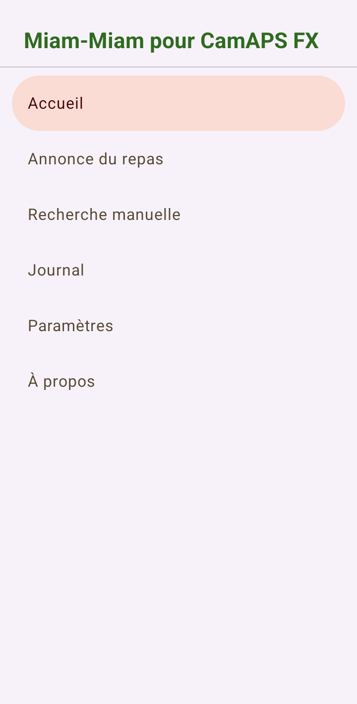

Le menu **☰** contient six entrées :

| Entrée | Ce qu'on y trouve |
| :-- | :-- |
| 🏠 **Accueil** | l'écran ci-dessus |
| 🍽️ **Annonce du repas** | la conversation avec Gemini |
| 🔍 **Recherche manuelle** | chercher un produit soi-même |
| 📖 **Journal** | tout ce qui a été fait, repas par repas |
| ⚙️ **Paramètres** | les réglages |
| ℹ️ **À propos** | version, mise à jour, aide |

> [!TIP]
> **Trois façons de lancer un repas :** dire **« Miam-miam »** près du téléphone ; toucher la
> tuile **Miam-miam** dans les raccourcis du haut de l'écran (en glissant deux fois vers le bas) ;
> ou ouvrir l'application.

---

## 5. Votre premier repas, en photo

Exemple : un plateau avec une soupe, des pâtes et un yaourt.

### Étape 1 : poser un repère

🍴 Posez une **fourchette ou une cuillère** à côté de l'assiette. Gemini connaît leur taille : il
s'en sert pour estimer les quantités.

### Étape 2 : photographier

Touchez **« Photographier l'assiette »**. Le conseil de la fourchette s'affiche et Miam-Miam le dit
au premier cliché.

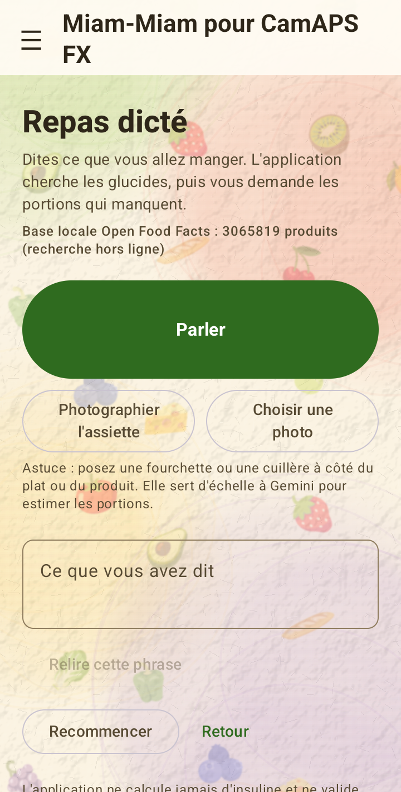

### Étape 3 : une autre photo ?

Après chaque photo, Miam-Miam demande :

<!-- Capture à prendre : images/manuel/04-autre-photo.png (carte « Autre photo / Envoyer à Gemini / Annuler »). -->

| Bouton | Quand le toucher |
| :-- | :-- |
| 📷 **Autre photo** | pour montrer un autre plat, le dessus d'un paquet, un détail |
| 📤 **Envoyer à Gemini** | quand tout est photographié |
| ✖️ **Annuler** | pour tout reprendre |

> [!TIP]
> Vos photos sont déjà dans la galerie ? Touchez **« Choisir une photo »** et sélectionnez-en
> **jusqu'à 6** d'un coup.

### Étape 4 : lire la réponse de Gemini

Après quelques secondes (7 à 11 en moyenne), la carte **« Réponse de Gemini »** apparaît.

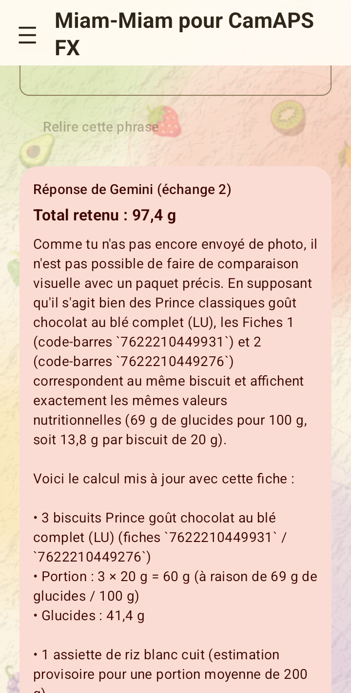

```
┌────────────────────────────────────────────┐
│ Réponse de Gemini (échange 1)              │
│ Total : 62 g   (fourchette 55 à 70 g)      │
│ ────────────────────────────────────────── │
│ | Aliment          | Quantité | Glucides | │
│ | Potage légumes   | 250 ml   |   12 g   | │
│ | Pâtes cuites     | 150 g    |   38 g   | │
│ | Yaourt nature    | 125 g    |    6 g   | │
│ | Pain             | 1 tranche|   ?      | │
│ Combien de tranches de pain ?              │
└────────────────────────────────────────────┘
```

*(Exemple simplifié ; Gemini rédige sa réponse librement.)*

- Le **total** et la **fourchette** sont repris en haut.
- Le texte complet de Gemini, avec ses tableaux, est affiché en dessous.
- Une phrase courte est **dite à voix haute**.

### Étape 5 : répondre aux questions

S'il manque une information, Gemini **pose une question**, que Miam-Miam lit à voix haute :

> 🔊 *« Combien de tranches de pain avez-vous mangées ? »*
>
> 🎙️ *« Une seule. »*

Votre réponse repart à Gemini, qui recalcule. Vous pouvez aussi dire à tout moment :

| Vous dites | Ce qui se passe |
| :-- | :-- |
| *« Ajoute une compote »* | Gemini ajoute la compote et recalcule |
| *« Non, c'était 200 grammes de pâtes »* | Gemini corrige |
| *« Retire le dernier »* | le dernier ajout est enlevé |
| *« Annule tout »* | la conversation repart de zéro |

### Étape 6 : annoncer

Quand Gemini a **tout** compté, sans rien supposer :

> 🔊 *« 68 grammes. Repas ou collation ? »* → 🎙️ *« Repas »*
>
> 🔊 *« Je confirme 68 grammes, repas ? »* → 🎙️ *« Oui »*

Passez au [chapitre 9](#9-confirmer-dans-camaps-fx).

**Avec Liberty**, pas de question « Repas ou collation ? » ni « Je confirme ? » :

> 🔊 *« 68 grammes de glucides. Mode Liberty : rien dans CamAPS, je note le repas. »*

Le repas est rangé dans le Journal (et dans le Carnet Glooko et Nightscout si le mode « Suivi »
est activé). **N'allez pas l'annoncer vous-même dans CamAPS FX.**

> [!CAUTION]
> Tant que Gemini a un doute (une question en attente, un plat absent de la photo), Miam-Miam
> **n'envoie rien** à CamAPS. Répondez d'abord à la question.

---

## 6. Un repas sans photo, à la voix

Pas besoin de photo pour un en-cas ou une boisson.

1. Dites **« Miam-miam »**, ou touchez **« Parler »**.
2. Dites simplement ce que vous prenez :

   > 🎙️ *« J'ai bu une tasse de lait chocolaté. »*

3. Gemini calcule, ou demande ce qui manque :

   > 🔊 *« Une tasse de combien ? 200 ou 250 millilitres ? Avec quelle poudre ? »*

4. Répondez, puis confirmez comme d'habitude (avec Liberty : rien à confirmer, le repas est
   simplement noté).

> [!TIP]
> Plus vous êtes précis, moins il y a de questions : *« Un bol de 250 ml de lait demi-écrémé avec
> deux cuillères de Nesquik »*.

---

## 7. Les produits du commerce

Pour un biscuit, un yaourt de marque ou une boisson, Miam-Miam va chercher la **vraie fiche** du
produit dans **Open Food Facts**, la grande base collaborative des étiquettes.

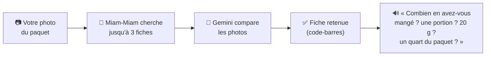

Sous la réponse de Gemini, la carte **« Fiches Open Food Facts comparées par Gemini »** montre
les fiches candidates. Celle que Gemini a retenue est **cochée**.

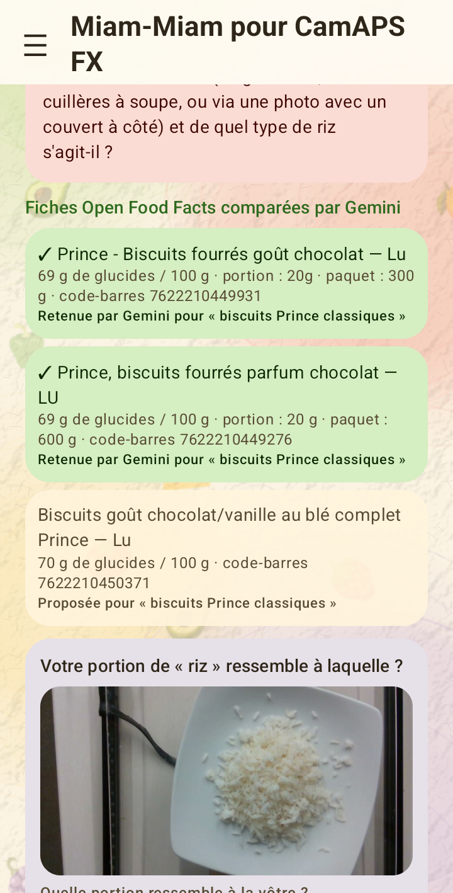

**Exemple réel :** trois biscuits Prince photographiés. Miam-Miam propose la fiche Prince et
celle d'un Petit Beurre ; Gemini reconnaît le Prince, recalcule avec l'étiquette et trouve
**41,4 g**.

> [!TIP]
> Photographiez **la face avant du paquet** ; si possible, ajoutez une photo du **code-barres**
> ou du **tableau nutritionnel**. Le code-barres donne la fiche exacte.

---

## 8. Les aliments sans marque : les portions en photos

Pour le riz, les pâtes, les fruits, les légumes ou les plats courants, Miam-Miam affiche une
rangée de **photos de portions pesées** :

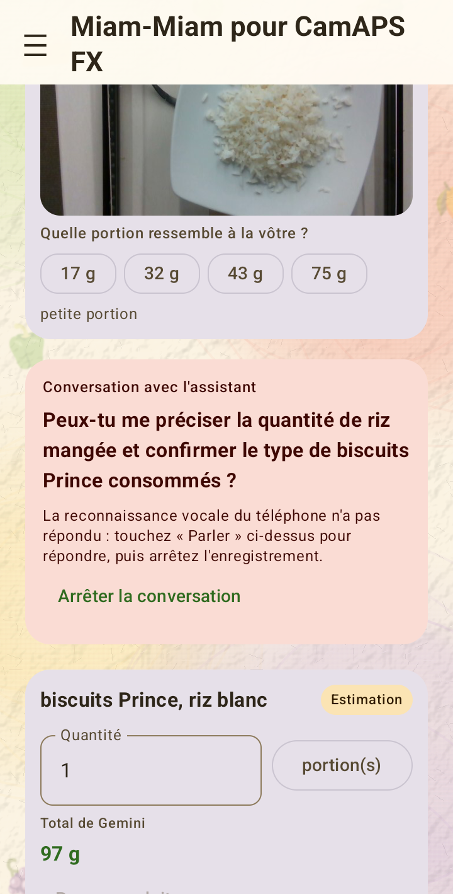

```
Votre portion de « riz » ressemble à laquelle ?
┌────────┐ ┌────────┐ ┌────────┐
│  🍚    │ │  🍚🍚  │ │ 🍚🍚🍚 │
│ 100 g  │ │ 200 g  │ │ 300 g  │
└────────┘ └────────┘ └────────┘
```

**Touchez la photo qui ressemble à votre assiette.** Miam-Miam dit à Gemini *« ma portion
ressemble à celle de 200 g »* et Gemini recalcule.

La banque compte **862 aliments** et **2 195 photos**, prises par des photographes qui ont
accepté de les partager.

---

## 9. Confirmer dans CamAPS FX

> [!CAUTION]
> **Ce chapitre ne concerne PAS les utilisateurs de Liberty.** Avec Liberty, Miam-Miam n'ouvre
> pas CamAPS FX, et vous n'annoncez pas le repas dans « Ajouter un repas » ni ne faites de bolus
> avec l'onglet couteau-fourchette. Voir le [chapitre 0](#0-avant-tout--utilisez-vous-liberty-).

Après votre **« oui »** :

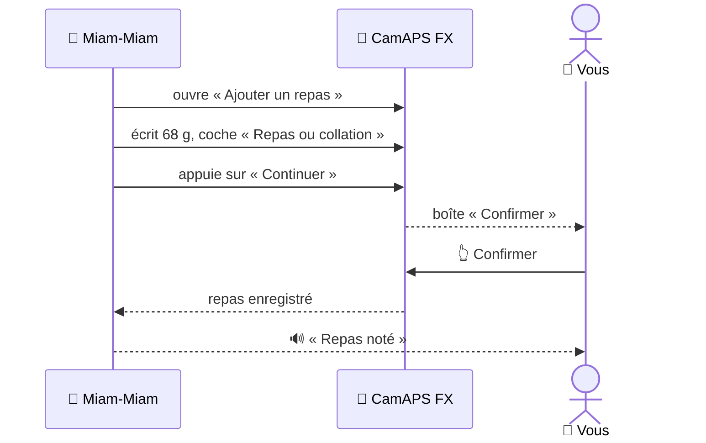

1. Miam-Miam ouvre CamAPS FX, va dans **« Ajouter un repas »**, écrit les grammes et coche le
   type.
2. CamAPS affiche sa boîte **« Confirmer »**. **Vérifiez le nombre**, puis touchez
   **Confirmer**.
3. Ne touchez pas l'écran pendant que Miam-Miam remplit CamAPS : cela prend deux à trois
   secondes.

<!-- Pas de capture de CamAPS FX : l'écran « Ajouter un repas » n'est pas photographié (application médicale, glycémie à l'écran). -->

> [!IMPORTANT]
> **Comment savoir que c'est bien enregistré ?** Dans CamAPS, ouvrez l'historique des repas : la
> quantité y apparaît à l'heure de votre confirmation. Dans Miam-Miam, **☰ → Journal →
> Automatisations** affiche **« Jusqu'au bout »** ou **« CamAPS seulement »**.

> [!NOTE]
> Si la saisie automatique est désactivée, Miam-Miam ouvre simplement CamAPS et vous rappelle le
> nombre à taper.

---

## 10. Pour votre diabétologue : le mode « Suivi »

**Paramètres → Repas & CamAPS → Mode suivi diabétologue.**

Au quotidien, vous n'en avez pas besoin : CamAPS suffit. Avant un rendez-vous, activez ce mode
quelques jours : chaque repas confirmé est aussi noté pour votre médecin.

| Où | Ce qui est écrit | Exemple |
| :-- | :-- | :-- |
| 📒 **Carnet Glooko** | le détail du repas, aliment par aliment | *« Gemini : potage 12 g, pâtes 38 g, yaourt 6 g, pain 12 g »* |
| 📈 **Nightscout** | les glucides et le même détail en note | *68 g · « Miam-Miam (Gemini) : potage 12 g… »* |

> [!IMPORTANT]
> **Avec Liberty**, rien ne passe plus par CamAPS : ce mode devient **la seule trace** de vos repas
> pour votre médecin. Il est conseillé de le laisser activé.

> [!NOTE]
> **Pas de double comptage.** Le Carnet Glooko reçoit seulement le texte : les grammes y arrivent
> déjà par CamAPS (sauf avec Liberty). Côté Nightscout, si les mêmes glucides sont déjà arrivés par Glooko à la même
> heure (à 30 minutes près), Miam-Miam n'envoie que la note.

---

## 11. Le Journal : retrouver et rattraper un repas

**☰ → Journal**, trois onglets :

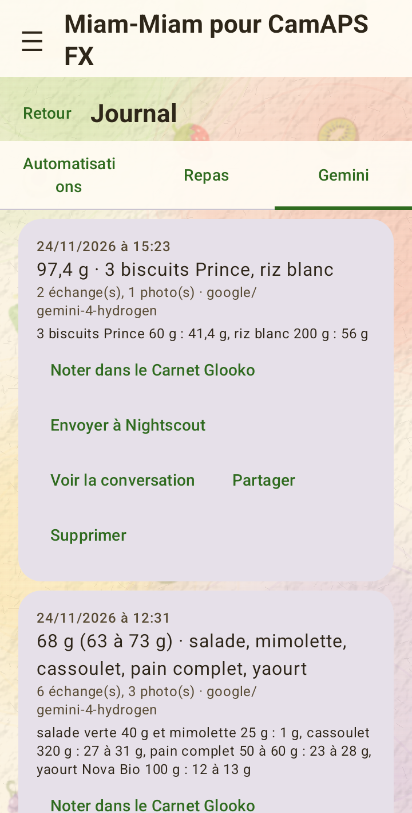

| Onglet | Ce que vous y voyez |
| :-- | :-- |
| ⚙️ **Automatisations** | chaque envoi à CamAPS et ce qu'il est devenu : ✅ *Jusqu'au bout*, 🟡 *CamAPS seulement*, ⚪ *Annulé*, 🔴 *Échec* ; avec Liberty : 🔵 *Liberty (noté, rien dans CamAPS)* |
| 🍽️ **Repas** | l'historique des repas avec leur total ; bouton **Favori** |
| 🤖 **Gemini** | chaque repas mené avec Gemini : **toute la conversation**, le total, la liste des **Envois** avec l'heure |

Sur une carte de l'onglet **Gemini** :

| Bouton | Usage |
| :-- | :-- |
| **Voir la conversation** | relire tout l'échange, tableaux compris |
| **Partager** | envoyer le repas en texte (courriel, messagerie) |
| **Noter dans le Carnet Glooko** | rattraper un repas qui n'a pas été écrit dans Glooko |
| **Envoyer à Nightscout** | rattraper un repas qui n'est pas parti vers Nightscout |

> [!TIP]
> Si CamAPS a été rempli **à la main**, la suite (Glooko, Nightscout) ne part pas toute seule :
> utilisez ces deux boutons. L'heure envoyée reste celle du repas dans CamAPS, pas celle du
> rattrapage : rien n'est compté deux fois.

> [!NOTE]
> Les **photos ne sont pas gardées** dans le journal, seule la mention « avec une photo »
> l'est.

---

## 12. Chercher un produit à la main, garder ses favoris

**☰ → Recherche manuelle** : pratique quand on a le paquet sous les yeux.

1. Tapez le nom ou la marque, touchez **Chercher**. La base du téléphone répond même sans
   Internet ; cochez **« Chercher aussi en ligne »** pour un produit très récent.
2. Touchez **Ajouter** sur le bon produit.
3. Choisissez comment vous comptez : **au poids**, **au volume**, **à la pièce**, **à la
   portion** ou **au paquet**, puis la quantité. La formule s'affiche.
4. Répétez pour chaque produit : ils s'ajoutent à **« Mon repas »**.
5. Touchez **« Lancer l'automatisation (CamAPS FX) »**. Avec Liberty, le bouton s'appelle
   **« Noter le repas (Liberty : rien dans CamAPS) »** et le choix du type de repas disparaît.

⭐ **Favoris** : un repas habituel (votre petit-déjeuner, par exemple) s'enregistre avec
**« Enregistrer en favori »** et se recharge ensuite en un geste.

---

## 13. Bien photographier son assiette

| ✅ À faire | ❌ À éviter |
| :-- | :-- |
| 🍴 une **fourchette ou une cuillère** à côté | une assiette seule, sans repère de taille |
| 📐 photo **de dessus**, toute l'assiette dans le cadre | un plat coupé par le bord de la photo |
| 💡 une **bonne lumière** | contre-jour, flash qui écrase les volumes |
| 📷 **plusieurs photos** si plusieurs plats | un plateau entier trop loin |
| 🏷️ la **face avant** et le **code-barres** des paquets | un emballage froissé ou dans l'ombre |
| 🗣️ **dire** ce que la photo ne montre pas (*« les pâtes sont complètes »*, *« sans sucre »*) | laisser Gemini deviner une sauce cachée |

---

## 14. Les réglages utiles

**☰ → Paramètres**, six onglets :

| Onglet | Le réglage à connaître |
| :-- | :-- |
| **Général** | Assistant d'installation ; clé OpenRouter ; **Sauvegarde** (pour changer de téléphone) |
| **Repas & CamAPS** | **« J'utilise la fonction Liberty de CamAPS FX »** (tout en haut) ; **Mode Gemini direct** (activé par défaut) ; **Insertion automatique dans CamAPS FX** (cachée avec Liberty) ; **Mode suivi diabétologue** |
| **Voix** | choix de la voix ; écoute permanente du mot « Miam-miam » |
| **Données** | importer vos propres portions en photos |
| **Courses** | vos magasins habituels ; import de vos factures de courses |
| **Avancé** | adresse et jeton de votre Nightscout, bouton de test |

> [!WARNING]
> Le fichier de **sauvegarde** contient vos clés **en clair**. Gardez-le pour vous, ne l'envoyez
> à personne.

**Mettre à jour l'application :** **☰ → À propos → Mises à jour → Vérifier maintenant**, puis **Télécharger et installer**. Vos réglages et
votre journal sont conservés.

---

## 15. Que faire si…

| Situation | Que faire |
| :-- | :-- |
| 🩺 **Je ne sais pas si j'utilise Liberty** | **demandez à votre diabétologue** avant de répondre ; d'ici là, n'utilisez pas l'envoi vers CamAPS |
| 💉 **J'utilise Liberty mais Miam-Miam propose « Écrire dans CamAPS »** | le réglage Liberty est coupé : ☰ → Paramètres → Repas & CamAPS → activez **« J'utilise la fonction Liberty de CamAPS FX »** |
| 🟥 **Un bandeau rouge** s'affiche sur l'accueil | la saisie automatique est coupée (souvent après une mise à jour) : touchez ses deux boutons et réactivez les deux services ([chapitre 3 ⑥](#-autoriser-la-saisie-dans-camaps-fx-et-glooko)) |
| ❓ **Gemini pose beaucoup de questions** | ajoutez une photo, une fourchette pour l'échelle, ou précisez à la voix quantités et marques |
| 🤔 **Le total me paraît faux** | regardez le tableau de Gemini, corrigez à la voix (*« non, 100 grammes de riz »*). En cas de doute, **ne confirmez pas** dans CamAPS |
| 📒 **« Carnet Glooko : échec »** | Glooko a mis trop de temps à s'ouvrir : ☰ → Journal → Gemini → **Noter dans le Carnet Glooko** |
| 📈 **Le repas n'est pas dans Nightscout** | ☰ → Journal → Gemini → **Envoyer à Nightscout** |
| 💉 **CamAPS n'a pas été rempli** | **sans Liberty** : remplissez-le à la main (le nombre est affiché), puis rattrapez Glooko et Nightscout depuis le Journal. **Avec Liberty : c'est normal, n'y touchez pas** |
| 📶 **Pas d'Internet** | Gemini ne répond pas sans réseau : utilisez la **Recherche manuelle**, qui marche hors ligne |
| 🎙️ **Miam-Miam ne m'entend pas** | vérifiez l'autorisation du micro (Assistant d'installation, étape 4) ; parlez près du téléphone, sans bruit de fond |
| 📦 **Les données hors ligne ne s'installent pas** | mettez le téléphone en Wi-Fi et en charge ; ou Paramètres → Général → Assistant → bouton de téléchargement |
| 🆘 **Autre problème** | ☰ → À propos → Mode debug → **Envoyer les journaux maintenant** au support Geeks4Good : vous recevez un numéro de ticket |

---

## 16. Petit lexique

| Mot | Ce que ça veut dire |
| :-- | :-- |
| **Glucides** | les sucres et amidons d'un aliment, comptés en grammes ; c'est ce que CamAPS doit connaître |
| **CamAPS FX** | l'application qui pilote votre pompe à insuline selon votre glycémie (« boucle fermée ») |
| **Ajouter un repas** | l'écran de CamAPS où l'on annonce les glucides ; c'est une information, pas une injection. **Avec Liberty, on ne l'utilise pas** |
| **Liberty** | une fonction de CamAPS FX ; son utilisation se décide **avec votre diabétologue**. Avec Liberty, on n'annonce pas les repas dans « Ajouter un repas » |
| **Onglet couteau-fourchette** 🍴 | l'onglet de CamAPS FX qui sert aux repas et aux bolus. **Avec Liberty, pas de bolus par cet onglet** |
| **Gemini** | l'intelligence artificielle de Google qui regarde vos photos et compte les glucides |
| **OpenRouter** | le service par lequel Miam-Miam interroge Gemini ; il facture à l'usage, quelques centimes par repas |
| **Open Food Facts** | une base libre de millions d'étiquettes de produits du commerce |
| **Glooko** | l'application de suivi que votre équipe soignante consulte ; son **Carnet** garde des notes |
| **Nightscout** | un site personnel qui affiche vos courbes de glycémie et vos repas |
| **Accessibilité** | une permission d'Android qui permet à Miam-Miam de toucher les boutons de CamAPS à votre place |
| **Fourchette (de glucides)** | l'écart entre le minimum et le maximum probables : plus elle est large, plus il faut préciser |

---

<sub>Miam-Miam n'est affilié ni à CamDiab (CamAPS FX), ni à Glooko, ni à Google, ni à Open Food
Facts, ni à Nightscout. Il ne remplace pas l'avis de votre équipe soignante. Pour l'utilisation
de Liberty, référez-vous à votre diabétologue.</sub>
